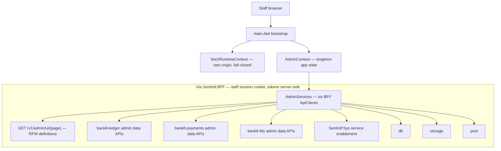

# README.md: Bank8:Admin — Vertical Admin Console App

> Third-party Sentin8:App application (staff-only). It uses the Sentin8
> Flutter SDK (`sdk/flutter/sentin8`) as a published package. For wire-level
> detail read `DESIGN.md`; for the business view read `BUSINESS.md`.

## 1. Summary

Admin is the staff-only vertical admin console of the Bank8 vertical: it
exposes the Bank8:Ledger, Bank8:Payments, and Bank8:FDX admin surfaces
(ledger products/accounts/postings/schedules/DLQ/balances/customers/audit,
payment instructions/rules/cards/files/decisions/mandates and more, FDX
provider/recipients/consents) plus sentin8 service-enablement settings and a
service-health overview. Admin surfaces are consumed in two styles: the
services' own RFW-rendered admin pages and a set of hand-written Flutter
pages over the same admin APIs.

## 2. Motivation

Every Bank8 service already publishes an admin UI over the platform's RFW
contract (`GET /v1/admin/ui/{page}` + `POST /v1/admin/{resource}` data
callbacks), so a vertical admin console must be a **pure rendering host**
with zero duplicated backend knowledge: it renders whatever the services
declare, adds the platform glue (staff session, service health, service
enablement), and ships hand-written pages only where a bespoke workflow
earns it.

## 3. Architecture & High-Level Design

Components:

- **Bootstrap** — `fetchRuntimeContext()` (SDK) from the app's own origin;
  failure renders the inline error page (fail closed), never a degraded
  console.
- **`AdminContext`** (`app_context.dart`) — the app's singleton state holder
  (runtime context + auth + services).
- **`AdminServices`** (`services.dart`) — six BFF proxy clients: `ledger`,
  `payments`, `fdx`, `db`, `storage`, `post`.
- **RFW host** (`rfw/rfw_page.dart`) — thin wrapper over the SDK's shared
  `Sentin8RfwPage`: fetches `GET /proxy/{service}/v1/admin/ui/{page}`, parses
  the RFW definition, renders it, and submits forms back through the BFF
  (`POST /proxy/{service}/v1/admin/{resource}` aliases); supports `extraProps`
  parameterized pages (skipping the RFW definition cache).
- **Shell** (`admin_shell.dart`) — hash routing with an expandable sidebar
  tree; dispatches overview/settings pages and routes `/ledger/…`,
  `/payments/…`, `/fdx/…` to the RFW/host-written section pages.
- **Hand-written section pages** — ledger/payments/fdx section pages over the
  same admin data APIs (list + form patterns).

## 4. Key Traits and Data Structures

- **`AdminContext` singleton**: one console instance per browser session;
  the singleton makes the shell's sidebar/state dispatch trivial and matches
  the single-window staff console reality.
- **`Bank8RfwPage`**: the service→RFW bridge — maps a logical service name to
  the right BFF client and delegates definition fetch/render/submit to the
  SDK renderer; the app owns no RFW schema itself.
- **Section dispatch pattern** (`LedgerSectionPage` / `PaymentsSectionPage` /
  `FdxSectionPage`): one overview page with navigation chips plus a section
  switch, so adding an admin section = a route case + a section page, never a
  shell change.
- **Staff scope manifest**: the app's listing carries the union of read/write
  admin scopes across ledger/payments/fdx (plus platform `db`/`storage`
  scopes) with `auth_mode: staff`; the authority check happens in the BFF and
  services, never in the client.

## 5. Rationale, Trade-offs, and Alternatives

- **RFW-first with hand-written fallbacks.** Services own their admin UX as
  RFW definitions (platform `architecture-principles` §4.15); the console
  renders them unchanged, so backend capability and admin UX stay in lockstep
  and the console carries zero per-service page knowledge. A set of
  hand-written section pages exists where the RFW contract has not absorbed a
  workflow yet; they call the same admin data APIs. Rejected: a fully
  hand-written console (duplicates every service's admin UX and drifts) and a
  fully-RFW console (no home for platform-level glue pages like health and
  enablement).
- **POST-only mutation contract.** The RFW renderer supports POST; update and
  delete surface as POST alias routes on the services — the console follows
  that contract rather than inventing its own.
- **Singleton context over inherited-only.** An ops console is one window,
  one session, one user; the singleton removes provider-plumbing noise from
  deep section pages. Rejected for the customer apps (multi-journey state),
  right-sized here.
- **Staff-only listing.** `auth_mode: staff` and the admin-scope manifest
  make the console unreachable to customers at every layer; there is no
  customer journey to hide.

## 6. Internal Implementation & Invariants (Private Design)

- **Routes** (shell dispatch): `/` overview (service health cards via
  `GET /proxy/{service}/v1/health`), `/settings` (sentin8 service
  enablement via `GET /proxy/sys/v1/modules/services` +
  `PUT /proxy/sys/v1/env/{env_id}/services`), `LedgerSectionPage` for
  `/ledger/{products,accounts,postings,schedules,dlq,balances,customers,audit}`
  (+ reconcile/settings placeholders), `PaymentsSectionPage` for
  `/payments/{instructions,rules,cards,files,integrations,decisions,mandates,templates,calendars,dashboards}`,
  `FdxSectionPage` for `/fdx/{provider,recipients,consents}` (+ csdf/settings
  placeholders), and a fall-through of any `/ledger|payments|fdx/…` route to
  the RFW page.
- **RFW fetch/cache**: definitions are cached by the SDK renderer;
  parameterized pages (`extraProps`, e.g. `?type=current_account`)
  intentionally bypass the cache.
- **Invariants:**
  - The console performs no authorization decisions of its own; every
    mutation rides the service's admin data API and its admin-scope gate
    (`bank8:ledger:*`, `bank8:payments:*`, `bank8:fdx:*` admin scopes).
  - The console never embeds backend knowledge: no table names, no vertical
    business rules in page code — page code renders definitions and list
    APIs.
  - Staff scope manifest is the only surface contract; adding an admin page
    needs a scope, not client code.
  - No token in the client; fail-closed bootstrap; CI guards enforce no
    direct-DB/storage/config access.

## 7. Unresolved Questions / Future Designs

- The fill-the-gap sections (`reconcile`, `csdf`, dashboards) are
  placeholder routes today; they land as their services publish the matching
  RFW definitions or admin APIs.
- Cross-service workflow views (multi-step operations spanning ledger +
  payments) may deserve a dedicated console surface once the underlying
  services emit correlated audit/flow state.

---

**Design attribution:** bank8:admin and its underlying concepts were designed by Hamid Jahanzad <Hamid@Jahanzad.com>.
